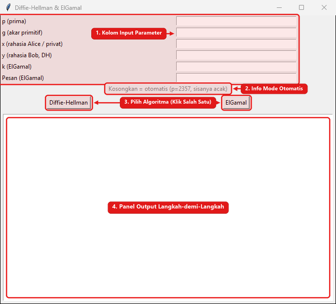
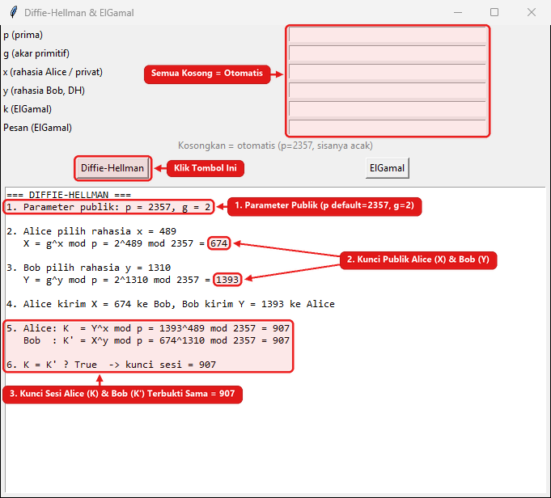
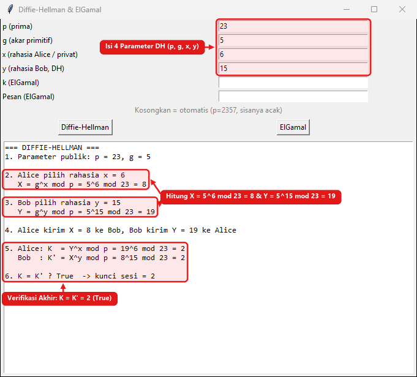
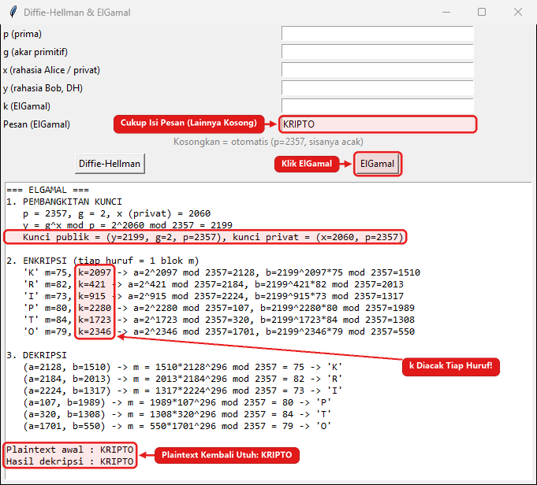
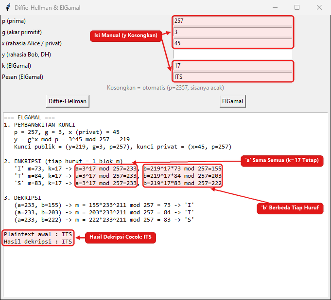
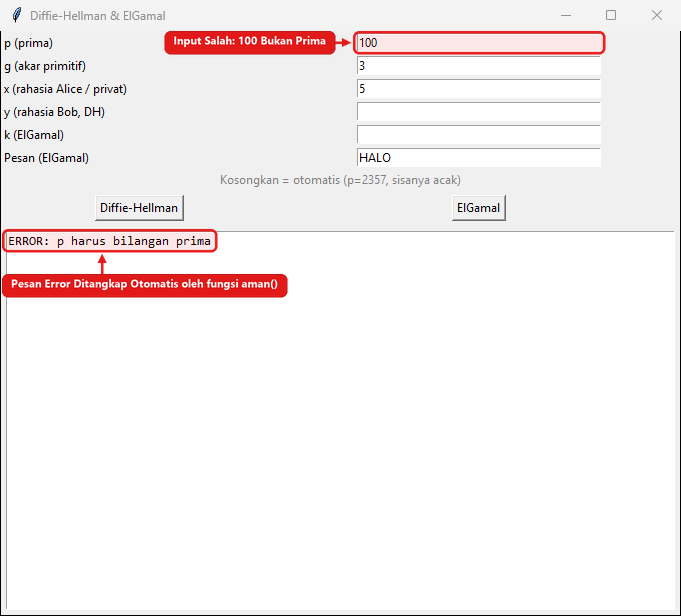
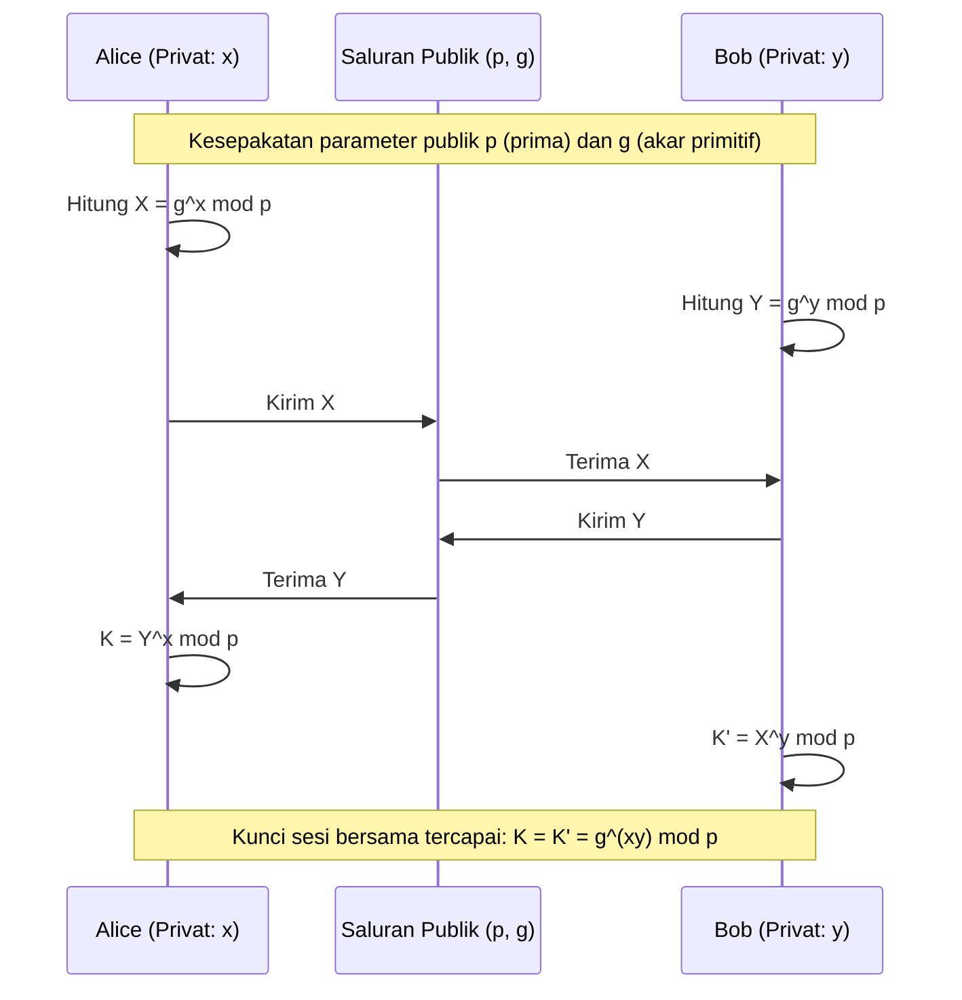
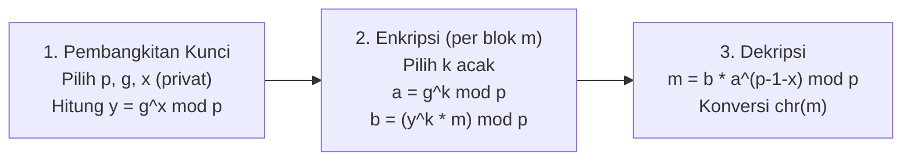

# Implementasi Diffie-Hellman & ElGamal (GUI Python)

Aplikasi desktop berbasis **Python Tkinter** yang mengimplementasikan dua algoritma kriptografi kunci publik (*Public-Key Cryptography*) yang keamanannya bertumpu pada **Discrete Logarithm Problem (DLP)**:

1. **Diffie-Hellman Key Exchange** — Protokol pertukaran kunci untuk menghasilkan kunci rahasia bersama (*shared session key*) melalui saluran publik.
2. **Kriptosistem ElGamal** — Skema enkripsi dan dekripsi asimetris berbasis blok karakter ASCII dengan kunci sementara acak (*ephemeral key*).

Aplikasi ini dirancang dengan output **step-by-step** yang menampilkan seluruh proses perhitungan aritmetika modular secara transparan sehingga mudah dipelajari dan diverifikasi secara manual.

---

## Anggota Kelompok

| No | Nama Lengkap | NRP |
| :-: | :--- | :--- |
| 1 | **Ahmad Yazid Arifuddin** | `5027241040` |
| 2 | **Muhammad Farrel Rafli Al Fasya** | `5027241075` |
| 3 | **Mohammad Abyan Ranuaji** | `5027241106` |

> **Mata Kuliah:** Kriptografi (Tugas 2) — Institut Teknologi Sepuluh Nopember (ITS)

---

## Daftar Isi

- [Penjelasan Kode (`dh_elgamal.py`)](#penjelasan-kode-dh_elgamalpy)
  - [1. Utilitas Matematika & Diffie-Hellman (Baris 1–39)](#1-utilitas-matematika--diffie-hellman-baris-139)
  - [2. Algoritma ElGamal & Validasi Input (Baris 40–79)](#2-algoritma-elgamal--validasi-input-baris-4079)
  - [3. Alur Eksekusi & Penanganan Error (Baris 80–157)](#3-alur-eksekusi--penanganan-error-baris-80157)
  - [4. Antarmuka Grafis Tkinter (Baris 158–188)](#4-antarmuka-grafis-tkinter-baris-158188)
- [Fitur Utama](#fitur-utama)
- [Struktur Direktori](#struktur-direktori)
- [Prasyarat & Instalasi](#prasyarat--instalasi)
- [Cara Menjalankan Aplikasi](#cara-menjalankan-aplikasi)
- [Panduan Penggunaan & Screenshot Step-by-Step](#panduan-penggunaan--screenshot-step-by-step)
  - [Referensi Kolom Input](#referensi-kolom-input)
  - [Step 1 — Tampilan Awal Aplikasi](#step-1--tampilan-awal-aplikasi)
  - [Step 2 — Simulasi Diffie-Hellman (Mode Otomatis)](#step-2--simulasi-diffie-hellman-mode-otomatis)
  - [Step 3 — Simulasi Diffie-Hellman (Mode Manual)](#step-3--simulasi-diffie-hellman-mode-manual)
  - [Step 4 — Enkripsi & Dekripsi ElGamal (Mode Otomatis)](#step-4--enkripsi--dekripsi-elgamal-mode-otomatis)
  - [Step 5 — Enkripsi & Dekripsi ElGamal (Mode Manual)](#step-5--enkripsi--dekripsi-elgamal-mode-manual)
  - [Step 6 — Validasi Input & Penanganan Error](#step-6--validasi-input--penanganan-error)
- [Landasan Teori & Rumus Matematis](#landasan-teori--rumus-matematis)
- [Catatan Implementasi & Batasan](#catatan-implementasi--batasan)

---

## Penjelasan Kode (`dh_elgamal.py`)

Secara keseluruhan, berkas [`dh_elgamal.py`](dh_elgamal.py) disusun menjadi empat bagian utama: fungsi matematika dan Diffie-Hellman (baris 1–39), inti algoritma ElGamal dan validasi input (baris 40–79), alur eksekusi beserta penanganan error (baris 80–157), serta susunan antarmuka Tkinter (baris 158–188).

### 1. Utilitas Matematika & Diffie-Hellman (Baris 1–39)

Bagian awal ini mengimpor modul `random` (untuk menghasilkan kunci rahasia acak saat input dikosongkan) serta `tkinter as tk` (untuk membangun GUI), lalu mendefinisikan fungsi bilangan prima, akar primitif, dan perhitungan Diffie-Hellman.

```python
def is_prime(n):
    if n < 2:
        return False
    for i in range(2, int(n ** 0.5) + 1):
        if n % i == 0:
            return False
    return True

def is_akar_primitif(g, p):
    for i in range(1, p - 1):
        if pow(g, i, p) == 1:
            return False
    return True

def cari_akar_primitif(p):
    for g in range(2, p):
        if is_akar_primitif(g, p):
            return g
```

- **`is_prime(n)` (baris 7–13):** Memeriksa apakah `n` bilangan prima. Bilangan di bawah `2` langsung mengembalikan `False`, sedangkan bilangan $\ge 2$ diuji apakah habis dibagi bilangan bulat dari `2` sampai $\lfloor\sqrt{n}\rfloor$.
- **`is_akar_primitif(g, p)` (baris 16–21):** Menguji apakah `g` adalah akar primitif modulo `p`. Fungsi menghitung `pow(g, i, p)` secara berurutan untuk `i` dari `1` sampai `p - 2`. Jika ada pangkat sebelum `p - 1` yang menghasilkan `1`, berarti orde `g` lebih kecil dari `p - 1` sehingga `False`.
- **`cari_akar_primitif(p)` (baris 24–27):** Digunakan saat pengguna mengosongkan kolom `g`. Fungsi mencoba kandidat `g` mulai dari `2` hingga `p - 1` dan langsung mengembalikan nilai pertama yang lolos `is_akar_primitif(g, p)`.

```python
def dh_kunci_publik(g, rahasia, p):
    return pow(g, rahasia, p)          # X = g^x mod p

def dh_kunci_sesi(publik_lawan, rahasia, p):
    return pow(publik_lawan, rahasia, p)   # K = Y^x mod p
```

- **`dh_kunci_publik(g, rahasia, p)` (baris 32–33):** Menghitung kunci publik Alice ($X = g^x \bmod p$) atau Bob ($Y = g^y \bmod p$) memanfaatkan fungsi perpangkatan modular bawaan Python `pow(base, exp, mod)`.
- **`dh_kunci_sesi(publik_lawan, rahasia, p)` (baris 36–37):** Menghitung kunci rahasia bersama dari kunci publik yang diterima lawan bicara dipangkatkan dengan bilangan rahasia milik sendiri modulo `p` ($K = Y^x \bmod p$ atau $K' = X^y \bmod p$).

---

### 2. Algoritma ElGamal & Validasi Input (Baris 40–79)

Bagian kedua berisi rumus pembangkitan kunci, enkripsi, dan dekripsi ElGamal, diikuti fungsi bantu untuk membaca nilai form GUI serta memvalidasi syarat matematisnya.

```python
def elgamal_buat_kunci(p, g, x):
    return pow(g, x, p)                # y = g^x mod p

def elgamal_enkripsi(m, p, g, y, k):
    a = pow(g, k, p)                   # a = g^k mod p
    b = (pow(y, k, p) * m) % p         # b = y^k * m mod p
    return a, b

def elgamal_dekripsi(a, b, p, x):
    return (b * pow(a, p - 1 - x, p)) % p   # m = b * a^(p-1-x) mod p
```

- **`elgamal_buat_kunci(p, g, x)` (baris 42–43):** Menghitung komponen kunci publik $y = g^x \bmod p$ dari bilangan prima `p`, akar primitif `g`, dan kunci privat `x`.
- **`elgamal_enkripsi(m, p, g, y, k)` (baris 46–49):** Mengenkripsi satu blok integer `m` menggunakan nilai acak sementara `k` untuk menghasilkan pasangan ciphertext `(a, b)`, dengan `a = g^k mod p` dan `b = (y^k * m) mod p`.
- **`elgamal_dekripsi(a, b, p, x)` (baris 52–53):** Memulihkan nilai `m` dari pasangan `(a, b)` menggunakan kunci privat `x`. Berdasarkan Teorema Kecil Fermat, invers modular $a^{-x} \bmod p$ dapat dihitung langsung sebagai `pow(a, p - 1 - x, p)` sebelum dikalikan dengan `b` modulo `p`.

```python
def baca(entry):
    teks = entry.get().strip()
    return int(teks) if teks else None

def ambil_p_g():
    p = baca(e_p) or 2357
    if not is_prime(p):
        raise ValueError("p harus bilangan prima")
    g = baca(e_g) or cari_akar_primitif(p)
    if not (1 < g < p and is_akar_primitif(g, p)):
        raise ValueError(f"g = {g} bukan akar primitif mod {p}")
    return p, g

def ambil_rahasia(entry, p):
    n = baca(entry) or random.randint(2, p - 2)
    if not 1 <= n <= p - 2:
        raise ValueError(f"Nilai rahasia harus 1 .. {p - 2}")
    return n
```

- **`baca(entry)` (baris 58–60):** Mengambil teks dari komponen `tk.Entry`, menghapus spasi di tepi menggunakan `.strip()`, lalu mengubahnya menjadi `int`. Jika kolom kosong, fungsi mengembalikan `None`. Jika diisi teks selain angka, `int(teks)` otomatis melempar `ValueError`.
- **`ambil_p_g()` (baris 63–70):** Mengambil nilai `p` (otomatis memakai `2357` jika kosong) lalu mengecek keprimaannya lewat `is_prime(p)`. Selanjutnya mengambil `g` (atau mencari otomatis lewat `cari_akar_primitif(p)`), kemudian memastikan `1 < g < p` dan `g` benar-benar akar primitif modulo `p`.
- **`ambil_rahasia(entry, p)` (baris 73–77):** Membaca bilangan rahasia (`x` atau `y`). Jika kosong, sistem memilih angka acak di rentang `2 .. p - 2`, lalu memastikan nilai akhirnya memenuhi batas `1 <= n <= p - 2`.

---

### 3. Alur Eksekusi & Penanganan Error (Baris 80–157)

Bagian ketiga menyatukan fungsi matematika dan input untuk menjalankan simulasi lengkap Diffie-Hellman maupun ElGamal, sekaligus mengamankan eksekusi tombol agar kesalahan input tidak membuat aplikasi berhenti tiba-tiba.

```python
def jalankan_dh():
    p, g = ambil_p_g()
    x = ambil_rahasia(e_x, p)
    y = ambil_rahasia(e_y, p)

    X = dh_kunci_publik(g, x, p)
    Y = dh_kunci_publik(g, y, p)
    K1 = dh_kunci_sesi(Y, x, p)
    K2 = dh_kunci_sesi(X, y, p)
    ...
```

- **`jalankan_dh()` (baris 82–103):** Mengambil parameter `p`, `g`, rahasia Alice `x`, dan rahasia Bob `y`. Setelah itu fungsi menghitung kedua kunci publik (`X` dan `Y`) serta kunci sesi dari masing-masing sisi (`K1` dan `K2`), lalu memformat seluruh perhitungannya ke dalam 6 langkah teks berurutan beserta hasil verifikasi `K1 == K2`.

```python
def jalankan_elgamal():
    p, g = ambil_p_g()
    x = ambil_rahasia(e_x, p)
    pesan = e_pesan.get()
    if not pesan:
        raise ValueError("Pesan tidak boleh kosong")
    if any(ord(c) >= p for c in pesan):
        raise ValueError("p terlalu kecil, harus lebih besar dari kode ASCII huruf")
    ...
    for c in pesan:
        m = ord(c)
        k = baca(e_k) or random.randint(1, p - 2)
        a, b = elgamal_enkripsi(m, p, g, y, k)
        cipher.append((a, b))
    ...
    for a, b in cipher:
        m = elgamal_dekripsi(a, b, p, x)
        plain += chr(m)
```

- **`jalankan_elgamal()` (baris 106–147):** Membaca parameter `p`, `g`, kunci privat `x`, dan string dari `e_pesan`. Fungsi terlebih dahulu menolak pesan kosong serta memastikan tidak ada karakter dengan kode ASCII `ord(c) >= p` (karena nilai pesan harus berada dalam modulo `p`). Setelah membangkitkan kunci publik `y`, setiap karakter diubah ke ASCII, dienkripsi satu per satu menjadi `(a, b)`—dengan `k` yang diacak per huruf jika input `k` dikosongkan—lalu didekripsi kembali menggunakan `elgamal_dekripsi()` dan disusun ulang dengan `chr(m)` untuk dicocokkan dengan plaintext awal.

```python
def aman(fungsi):
    out.delete("1.0", tk.END)
    try:
        out.insert(tk.END, fungsi())
    except ValueError as err:
        out.insert(tk.END, f"ERROR: {err}")
```

- **`aman(fungsi)` (baris 150–155):** Pembungkus (*wrapper*) yang dipanggil oleh kedua tombol GUI. Setiap kali tombol ditekan, kotak output `out` dikosongkan terlebih dahulu, lalu `fungsi()` dijalankan di dalam blok `try ... except ValueError`. Jika ada validasi yang gagal (seperti `p` bukan prima atau format bukan angka), pesan error ditampilkan rapi di kotak output dengan awalan `ERROR: `.

---

### 4. Antarmuka Grafis Tkinter (Baris 158–188)

Bagian terakhir membangun tata letak jendela utama aplikasi:

- **Inisialisasi & Helper Baris (baris 160–168):** Membuat window utama `root` berjudul `"Diffie-Hellman & ElGamal"` dan fungsi bantu `input_baris(baris, label)` untuk menempatkan pasangan `tk.Label` di kolom kiri dan `tk.Entry` (`width=40`) di kolom kanan menggunakan layout `.grid()`.
- **Komponen Input & Tombol (baris 171–186):** Mendaftarkan 6 field input (`e_p`, `e_g`, `e_x`, `e_y`, `e_k`, `e_pesan`), teks keterangan mode otomatis, tombol **Diffie-Hellman** (`command=lambda: aman(jalankan_dh)`), tombol **ElGamal** (`command=lambda: aman(jalankan_elgamal)`), serta kotak output `out` berupa `tk.Text(width=95, height=25, font=("Consolas", 10))`.
- **Event Loop (baris 188):** Menjalankan `root.mainloop()` agar jendela tetap aktif menerima interaksi pengguna.

---

## Fitur Utama

- **Tanpa Dependensi Eksternal:** Seluruh program berjalan hanya dengan pustaka standar Python (`tkinter` dan `random`).
- **Dual Mode Input (Otomatis & Manual):**
  - **Mode Otomatis:** Kolom parameter dapat dikosongkan. Program otomatis menggunakan bilangan prima bawaan `p = 2357`, mencari akar primitif terkecil `g`, dan membangkitkan nilai rahasia/acak secara otomatis.
  - **Mode Manual:** Pengguna bebas menentukan nilai `p`, `g`, `x`, `y`, `k`, dan `Pesan` untuk pengujian soal atau verifikasi perhitungan manual.
- **Pelacakan Perhitungan Step-by-Step:** Menampilkan rumus yang dijalankan beserta nilai numerik di setiap tahapan (pembangkitan kunci, pertukaran kunci publik, enkripsi tiap karakter, hingga dekripsi kembali).
- **Validasi Input Terpadu:** Memeriksa keprimaan `p`, validitas akar primitif `g`, rentang kunci rahasia `[1, p-2]`, ketersediaan pesan, kecukupan nilai `p` terhadap kode ASCII, serta kesalahan format angka.

---

## Struktur Direktori

```text
tugas 2/
├── dh_elgamal.py                        # File utama aplikasi GUI Diffie-Hellman & ElGamal
├── README.md                            # Penjelasan kode, dokumentasi lengkap, & panduan penggunaan
└── screenshots/                         # Tangkapan layar aplikasi step-by-step
    ├── 01-tampilan-awal.png             # Kondisi GUI saat pertama dibuka
    ├── 02-diffie-hellman-otomatis.png   # Hasil Diffie-Hellman dengan parameter otomatis
    ├── 03-diffie-hellman-manual.png     # Hasil Diffie-Hellman dengan parameter manual
    ├── 04-elgamal-otomatis.png          # Enkripsi & dekripsi ElGamal mode otomatis
    ├── 05-elgamal-manual.png            # Enkripsi & dekripsi ElGamal mode manual
    └── 06-validasi-error.png            # Contoh pesan validasi ketika input tidak valid
```

---

## Prasyarat & Instalasi

1. **Python 3.x** (diuji menggunakan Python `3.12.10`).
2. Modul **Tkinter** (sudah terpasang secara bawaan pada instalasi resmi Python di Windows/macOS; untuk sebagian distro Linux berbasis Debian/Ubuntu, pasang melalui `sudo apt install python3-tk`).
3. Tidak memerlukan `pip install` atau `virtual environment` khusus.

---

## Cara Menjalankan Aplikasi

### Melalui Terminal / PowerShell / Command Prompt

1. Buka terminal dan arahkan ke direktori proyek:
   ```powershell
   cd "c:\Users\ahmad\Documents\ITS\sem5\kripto\tugas 2"
   ```
2. Jalankan program:
   ```powershell
   python dh_elgamal.py
   ```
   *(Di Windows, perintah `py dh_elgamal.py` juga dapat digunakan).*

### Melalui Visual Studio Code

1. Buka folder proyek atau file `dh_elgamal.py` di VS Code.
2. Klik tombol **Run Python File** (`▶`) di pojok kanan atas editor, atau tekan **F5** / **Ctrl + F5**.

---

## Panduan Penggunaan & Screenshot Step-by-Step

> Setiap tangkapan layar pada panduan di bawah dilengkapi **anotasi/penanda berwarna merah** untuk memusatkan perhatian pada kolom input, tombol aksi, serta nilai perhitungan kunci di setiap tahapan.

### Referensi Kolom Input

| Kolom pada GUI | Variabel | Kegunaan di Diffie-Hellman | Kegunaan di ElGamal | Perilaku Jika Dikosongkan |
| :--- | :---: | :--- | :--- | :--- |
| **`p (prima)`** | `e_p` | Bilangan prima modulus | Bilangan prima modulus (`p > ord(c)`) | Default ke `2357` |
| **`g (akar primitif)`** | `e_g` | Basis / generator (`1 < g < p`) | Basis / generator (`1 < g < p`) | Dicari otomatis akar primitif terkecil |
| **`x (rahasia Alice / privat)`** | `e_x` | Kunci rahasia Alice (`1 .. p-2`) | Kunci privat penerima (`1 .. p-2`) | Diacak (`random.randint(2, p - 2)`) |
| **`y (rahasia Bob, DH)`** | `e_y` | Kunci rahasia Bob (`1 .. p-2`) | *Tidak digunakan (abaikan)* | Diacak (`random.randint(2, p - 2)`) |
| **`k (ElGamal)`** | `e_k` | *Tidak digunakan (abaikan)* | Bilangan acak enkripsi (*ephemeral key*) | Diacak unik untuk **setiap huruf** (`1 .. p-2`) |
| **`Pesan (ElGamal)`** | `e_pesan` | *Tidak digunakan (abaikan)* | Teks plaintext yang akan dienkripsi | **Wajib diisi** saat menekan tombol ElGamal |

---

### Step 1 — Tampilan Awal Aplikasi

Saat program pertama kali dijalankan, jendela **"Diffie-Hellman & ElGamal"** akan terbuka menampilkan 6 kolom input, catatan mode otomatis, 2 tombol eksekusi (**Diffie-Hellman** dan **ElGamal**), serta kotak output teks berfont *monospace* (`Consolas`).



---

### Step 2 — Simulasi Diffie-Hellman (Mode Otomatis)

Pada skenario ini, seluruh kolom input dibiarkan kosong lalu pengguna langsung mengklik tombol **Diffie-Hellman**.



**Penjelasan Output:**
1. **Parameter Publik:** Program otomatis memilih `p = 2357` dan mencari akar primitif terkecilnya yaitu `g = 2`.
2. **Sisi Alice:** Dipilih rahasia acak `x = 489`, lalu dihitung kunci publik Alice:
   `X = 2^489 mod 2357 = 674`
3. **Sisi Bob:** Dipilih rahasia acak `y = 1310`, lalu dihitung kunci publik Bob:
   `Y = 2^1310 mod 2357 = 1393`
4. **Pertukaran Publik:** Alice mengirim `X = 674` ke Bob, dan Bob mengirim `Y = 1393` ke Alice.
5. **Perhitungan Kunci Sesi:**
   - Alice menghitung `K = 1393^489 mod 2357 = 907`
   - Bob menghitung `K' = 674^1310 mod 2357 = 907`
6. **Verifikasi:** `K = K' ? True -> kunci sesi = 907`. Keduanya memperoleh kunci bersama yang identik.

---

### Step 3 — Simulasi Diffie-Hellman (Mode Manual)

Untuk menguji dengan angka pilihan sendiri (misalnya contoh klasik buku teks kriptografi):
- Isi **`p (prima)`** = `23`
- Isi **`g (akar primitif)`** = `5`
- Isi **`x (rahasia Alice / privat)`** = `6`
- Isi **`y (rahasia Bob, DH)`** = `15`
- Biarkan kolom `k` dan `Pesan` kosong, lalu klik **Diffie-Hellman**.



**Verifikasi Matematis:**
- Kunci publik Alice: $X = 5^6 \bmod 23 = 15625 \bmod 23 = 8$
- Kunci publik Bob: $Y = 5^{15} \bmod 23 = 19$
- Kunci sesi Alice: $K = 19^6 \bmod 23 = 2$
- Kunci sesi Bob: $K' = 8^{15} \bmod 23 = 2$
- Hasil akhir cocok: `K = K' ? True -> kunci sesi = 2`.

---

### Step 4 — Enkripsi & Dekripsi ElGamal (Mode Otomatis)

Untuk mencoba ElGamal secara cepat:
- Isi kolom **`Pesan (ElGamal)`** dengan teks, misalnya `KRIPTO`.
- Biarkan kolom `p`, `g`, `x`, `y`, dan `k` kosong, lalu klik **ElGamal**.



**Penjelasan Output:**
1. **Pembangkitan Kunci:**
   - Sistem memilih `p = 2357`, `g = 2`, dan kunci privat acak `x = 2060`.
   - Kunci publik dihitung: `y = 2^2060 mod 2357 = 2199`.
   - Kunci publik: `(y=2199, g=2, p=2357)` dan kunci privat: `(x=2060, p=2357)`.
2. **Enkripsi (Probabilistik per Karakter):**
   - Setiap karakter dikonversi menjadi kode ASCII `m = ord(c)` (`'K'=75`, `'R'=82`, `'I'=73`, `'P'=80`, `'T'=84`, `'O'=79`).
   - Karena kolom `k` dikosongkan, sistem membangkitkan nilai acak `k` yang **berbeda untuk setiap huruf** (`2097`, `421`, `915`, `2280`, `1723`, `2346`), sehingga nilai pasangan ciphertext `(a, b)` bersifat unik dan aman dari analisis frekuensi.
3. **Dekripsi:**
   - Setiap pasangan `(a, b)` didekripsi menggunakan eksponen `p - 1 - x = 2357 - 1 - 2060 = 296`:
     `m = b * a^296 mod 2357`
   - Seluruh kode ASCII berhasil dikembalikan menjadi plaintext `KRIPTO` secara tepat (`Plaintext awal : KRIPTO`, `Hasil dekripsi : KRIPTO`).

---

### Step 5 — Enkripsi & Dekripsi ElGamal (Mode Manual)

Untuk menguji ElGamal dengan parameter yang ditentukan sendiri:
- Isi **`p (prima)`** = `257` *(harus lebih besar dari kode ASCII seluruh karakter pesan)*
- Isi **`g (akar primitif)`** = `3`
- Isi **`x (rahasia Alice / privat)`** = `45`
- Biarkan **`y (rahasia Bob, DH)`** kosong
- Isi **`k (ElGamal)`** = `17`
- Isi **`Pesan (ElGamal)`** = `ITS`
- Klik tombol **ElGamal**.



**Penjelasan Output:**
- **Pembangkitan Kunci:** `y = 3^45 mod 257 = 219`.
- **Enkripsi:** Karena `k = 17` ditetapkan manual, seluruh karakter memakai `k` yang sama sehingga menghasilkan nilai `a = 3^17 mod 257 = 233` yang identik, sementara komponen `b` berbeda sesuai karakter masing-masing:
  - `'I'` (`m=73`) → `(233, 155)`
  - `'T'` (`m=84`) → `(233, 203)`
  - `'S'` (`m=83`) → `(233, 222)`
- **Dekripsi:** Menggunakan eksponen `p - 1 - x = 257 - 1 - 45 = 211`, setiap blok dikembalikan persis menjadi `'I'`, `'T'`, `'S'` (`Hasil dekripsi : ITS`).

---

### Step 6 — Validasi Input & Penanganan Error

Aplikasi membungkus pemanggilan algoritma dengan fungsi `aman()` untuk menangkap `ValueError` jika input tidak memenuhi syarat matematika atau aturan input. Sebagai contoh, saat **`p (prima)`** diisi `100` (bukan bilangan prima):



Kotak output langsung menampilkan pesan yang informatif:
```text
ERROR: p harus bilangan prima
```

**Daftar lengkap validasi error yang ditangani:**

| Kondisi Input Tidak Valid | Pesan Error yang Ditampilkan |
| :--- | :--- |
| Input angka diisi huruf/teks non-integer | `ERROR: invalid literal for int() with base 10: ...` |
| Nilai `p` bukan bilangan prima | `ERROR: p harus bilangan prima` |
| Nilai `g` di luar `1 < g < p` atau bukan akar primitif mod `p` | `ERROR: g = {g} bukan akar primitif mod {p}` |
| Nilai rahasia `x` atau `y` di luar rentang `[1, p - 2]` | `ERROR: Nilai rahasia harus 1 .. {p - 2}` |
| Kolom `Pesan (ElGamal)` kosong saat menekan tombol ElGamal | `ERROR: Pesan tidak boleh kosong` |
| Ada karakter pesan dengan kode ASCII $\ge p$ | `ERROR: p terlalu kecil, harus lebih besar dari kode ASCII huruf` |

---

## Landasan Teori & Rumus Matematis

### 1. Akar Primitif (*Primitive Root Modulo $p$*)

Suatu bilangan bulat $g$ ($1 < g < p$) disebut **akar primitif** modulo bilangan prima $p$ apabila $g$ memiliki orde $p - 1$ dalam grup perkalian $\mathbb{Z}_p^*$, yaitu:

$$g^i \not\equiv 1 \pmod p \quad \text{untuk semua } 1 \le i < p - 1$$

Dengan sifat ini, himpunan $\{g^1 \bmod p, g^2 \bmod p, \dots, g^{p-1} \bmod p\}$ menghasilkan permutasi lengkap dari seluruh elemen $\{1, 2, \dots, p-1\}$.

---

### 2. Diffie-Hellman Key Exchange



**Ringkasan Rumus:**
- **Kunci Publik Alice:** $X = g^x \bmod p$
- **Kunci Publik Bob:** $Y = g^y \bmod p$
- **Kunci Sesi Bersama:**
  $$K = Y^x \bmod p = (g^y)^x \bmod p = g^{xy} \bmod p = (g^x)^y \bmod p = X^y \bmod p = K'$$

---

### 3. Kriptosistem ElGamal



**Penjelasan Rumus Dekripsi (Teorema Kecil Fermat):**

Pada tahap enkripsi dihasilkan pasangan $(a, b)$ dengan:
$$a = g^k \bmod p, \qquad b = (y^k \cdot m) \bmod p = (g^{xk} \cdot m) \bmod p$$

Untuk memulihkan $m$, penerima perlu membagi $b$ dengan $a^x \equiv g^{kx} \pmod p$, atau mengalikan dengan invers modular $a^{-x} \bmod p$. Berdasarkan **Teorema Kecil Fermat** ($a^{p-1} \equiv 1 \pmod p$ untuk $p$ prima dan $p \nmid a$):

$$a^{-x} \equiv a^{p - 1 - x} \pmod p$$

Sehingga proses dekripsi menghitung:

$$b \cdot a^{p - 1 - x} \equiv (g^{xk} \cdot m) \cdot (g^k)^{-x} \equiv m \pmod p$$

---

## Catatan Implementasi & Batasan

1. **Tujuan Edukasi (*Educational Scope*):** Nilai default `p = 2357` dan pembangkitan acak `random.randint` digunakan untuk kemudahan simulasi dan verifikasi perhitungan manual. Untuk sistem keamanan produksi nyata, kriptografi modern membutuhkan bilangan prima aman minimal 2048-bit serta CSPRNG (`secrets`).
2. **Kompleksitas Pencarian Akar Primitif:** Fungsi `is_akar_primitif(g, p)` menguji pangkat secara berurutan $1 \dots p-2$ dengan kompleksitas $O(p \log p)$. Jika pengguna memasukkan bilangan prima yang sangat besar (misal ratusan ribu atau jutaan) sambil mengosongkan `g`, proses pencarian akar primitif akan berjalan lebih lambat.
3. **Penggunaan `k` pada ElGamal:** Jika kolom `k (ElGamal)` diisi manual, seluruh huruf pada pesan akan menggunakan nilai `k` yang sama (menyebabkan nilai `a` berulang di tiap blok). Untuk meniru perilaku ElGamal yang aman secara semantik, biarkan kolom `k` kosong agar diacak ulang pada setiap karakter.
4. **Input Angka `0`:** Pada `ambil_p_g()` dan `ambil_rahasia()`, pola `baca(entry) or ...` menganggap angka `0` sebagai *falsy* di Python sehingga input `0` otomatis diganti ke nilai default/acak.
5. **Syarat Panjang Karakter Terhadap `p`:** Karena setiap karakter dienkripsi per 1 nilai ASCII (`ord(c)`), nilai `p` harus lebih besar daripada nilai ASCII tertinggi pada pesan (minimal `p > 127` untuk teks ASCII standar).
